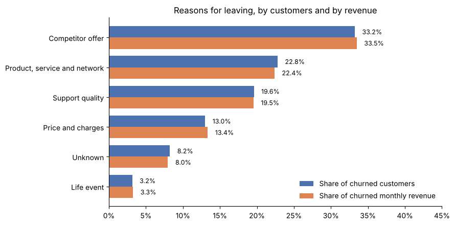
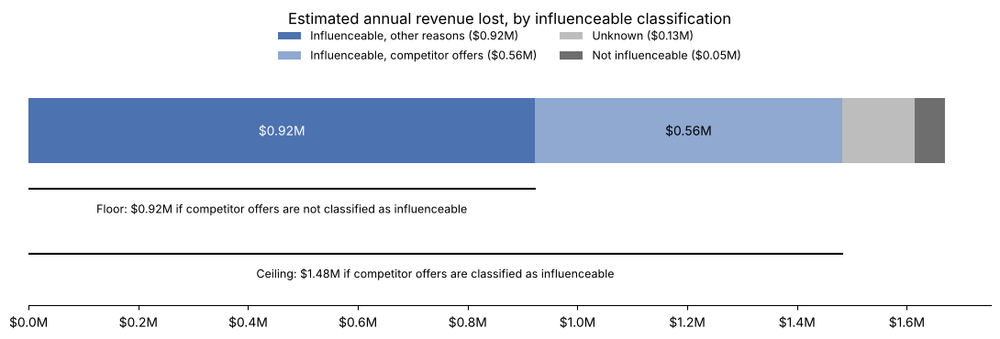
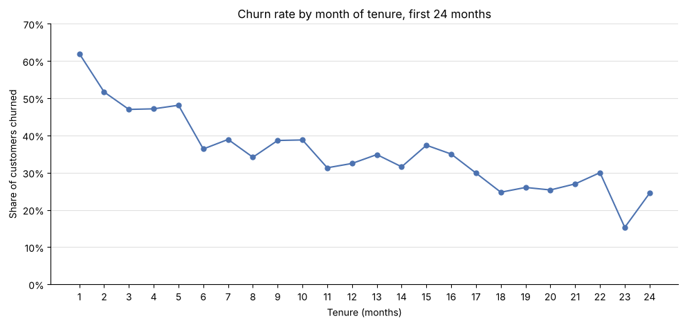
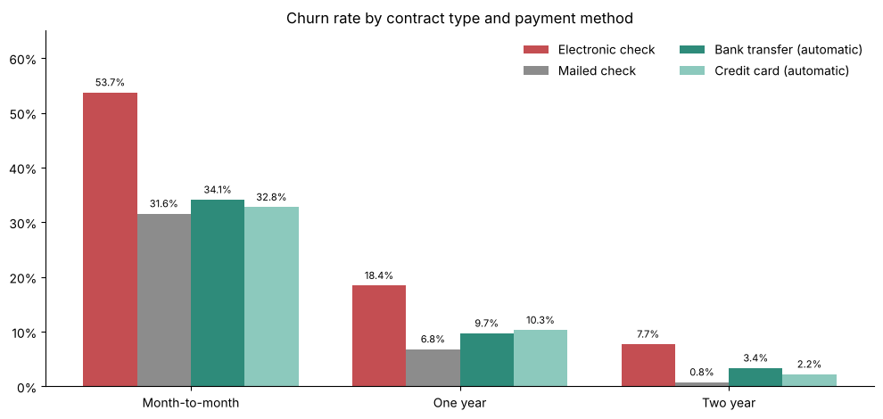
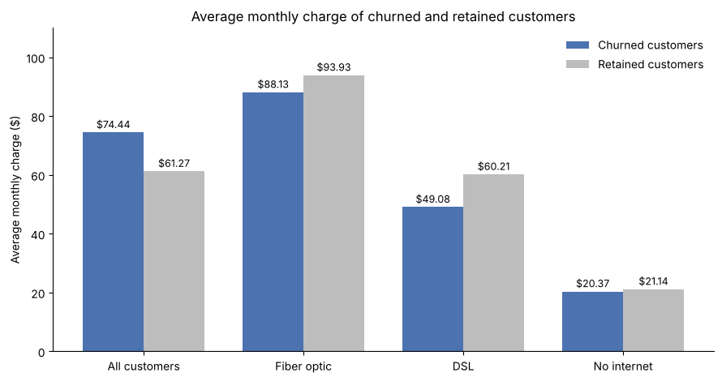
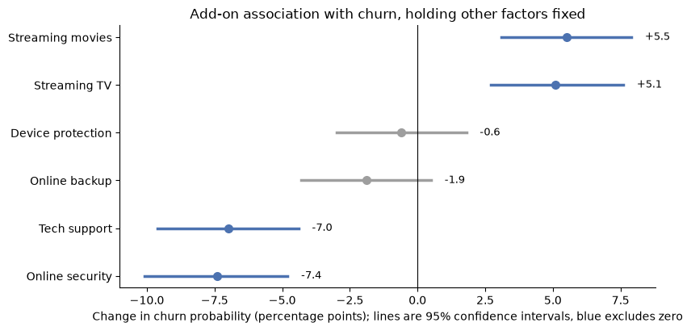
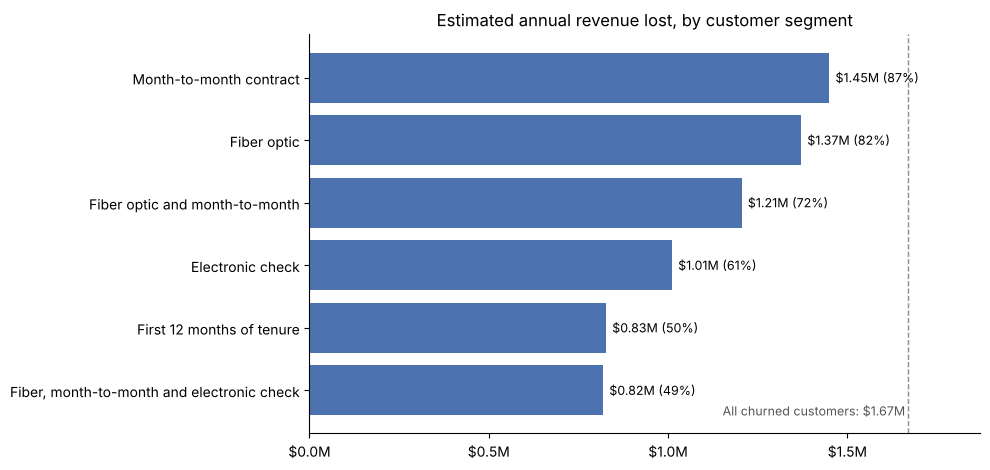

# Customer Churn and Revenue Retention Analysis

A revenue-focused analysis of customer churn for a telecom provider, built on IBM's public Telco Customer Churn sample (7,043 customers). The notebook audits and cleans the data, sizes how much recurring revenue churn removes, tests which contracts, services, add-ons and payment methods go with higher churn, and separates the revenue the company could have influenced from the revenue it could not. The data is synthetic, so the results demonstrate method and are not findings about a real company.

## The business question

Leadership has seen customers leave and wants to know why, how much revenue is going with them, and whether anything the company already records could help it keep more of them. The analysis answers six questions:

1. What reasons did customers give for leaving, and which cost the most revenue?
2. Which of those reasons could the company have influenced, and which could it not?
3. At what point in the customer relationship does churn happen?
4. Which contracts, services, add-ons and payment methods go with higher or lower churn?
5. How much does price matter?
6. What is missing from the records that would be needed to answer these questions properly?

## Key findings

Annual revenue figures are estimates: the monthly charges of churned customers multiplied by 12. They are not recognized revenue and not an amount the company could be sure to recover.

**Scale.** 26.5% of customers (1,869 of 7,043) and 30.5% of monthly charges churned, an estimated $1.67 million a year in lost recurring revenue.

**Why customers left.** Competitor offers are the largest stated reason at 33.2% of churners, followed by product, service and network issues (22.8%) and support quality (19.6%). Price and charges account for 13.0%. Reasons are self-reported, so they describe what customers said and not proven causes.



**What the company could have influenced.** Between $923,000 and $1.48 million a year of the lost revenue came from reasons the company could have influenced. The range depends on whether competitor offers are classified as influenceable, which is a judgment call and the decision leadership has to make. Only 3.2% of churners left for life events.



**When customers leave.** Of customers recorded at one month of tenure, 62.0% have churned, the highest of any month, and 55.5% of all churners left within the first year.



**Who leaves.** Month-to-month customers hold 88.6% of churners and fiber customers 69.4%. Fiber customers on month-to-month contracts churn at 54.6%.

**Payment method.** Electronic check customers churn at 45.3%, against 15.2% to 19.1% for the other methods. The gap holds within every contract type: on month-to-month contracts it is 53.7% against 31.6% to 34.1%.



**Price.** Churned customers pay more on average ($74.44 against $61.27), but within each internet service they pay less. The overall gap comes from the larger share of churners on fiber, the most expensive service (69.4% of churners), and not from churners paying more than other customers on the same service.



**Add-ons.** Tech support and online security are associated with about 7 points lower churn after accounting for contract, internet service and tenure, and streaming TV and streaming movies with about 5 points higher churn. This is an association and not proof that offering any of them would reduce churn.



**Where the money is.** Fiber optic customers on month-to-month contracts paying by electronic check are 18.6% of customers, churn at 60.4%, and account for 42.2% of churners and 49.1% of the lost revenue. The segments overlap, so their figures should not be added together.



The final part of the notebook turns these findings into five areas the company could test, with a success measure and a risk for each. It does not estimate how much churn a response would prevent.

## What the data could not answer

- Why customers left: reasons are self-reported and showed no statistically detectable difference between early and later churners.
- Competitor pricing, discount history and retention-offer responses: none are recorded.
- Why electronic check customers churn more: the data holds no failed-payment or billing-dispute records.
- Geography: 1,129 cities with a median of 4 customers each is too sparse to use.

## Data

IBM Telco Customer Churn sample, Cognos Analytics 11.1.3+: https://community.ibm.com/community/user/blogs/steven-macko/2019/07/11/telco-customer-churn-1113

The file is a fictional telecom provider in California with 7,043 customers and 33 columns. `Telco_customer_churn.xlsx` is the original, unmodified file, included for convenience. See the IBM page for its terms. The notebook never modifies it; the cleaned tables it creates are generated when it runs.

## Repository contents

| File | What it is |
|---|---|
| `Telco_churn.ipynb` | The full analysis: audit, cleaning, derived variables, baseline, eight questions, revenue roll-up, limits and next steps |
| `Telco_customer_churn.xlsx` | The original IBM dataset |
| `requirements.txt` | Library versions the notebook was run with |
| `images/` | Charts used in this README |

## Run it

Python 3.13 was used.

```
pip install -r requirements.txt
jupyter notebook Telco_churn.ipynb
```

Keep the Excel file in the same folder as the notebook, then run all cells. The notebook writes three CSV files: the cleaned table, the analysis table, and a third file holding the two model-generated columns (churn score and CLTV) that were set aside from the analysis to the same folder. They are listed in `.gitignore` because they are rebuilt each time.

## Tools

Python, pandas, NumPy, Matplotlib, SciPy (chi-square and Mann-Whitney tests), statsmodels (logistic regression with Holm-adjusted p-values for related tests).

## Licence

The code is released under the MIT Licence. The dataset belongs to IBM and is not covered by it.
